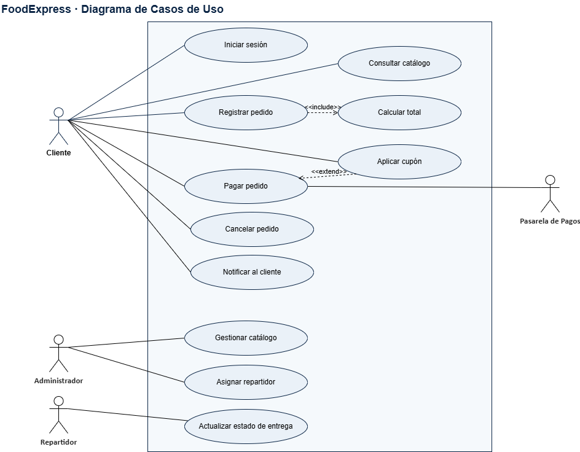
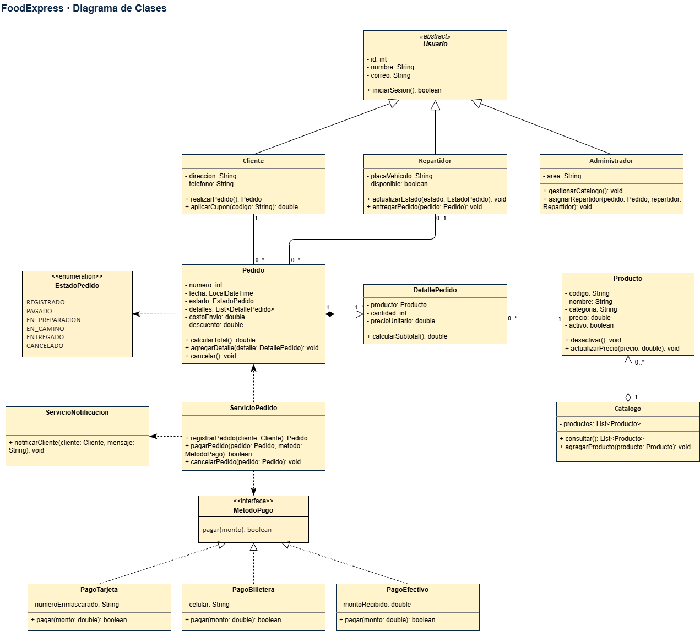
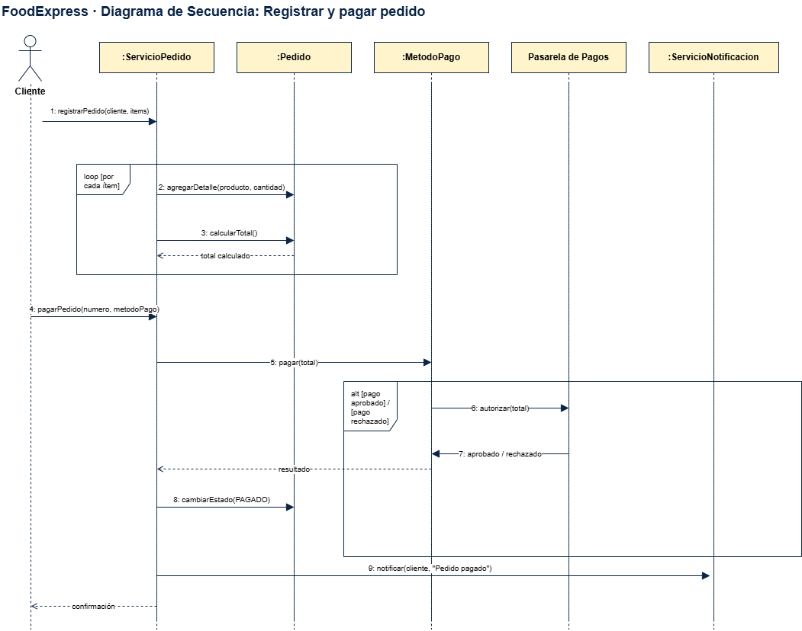
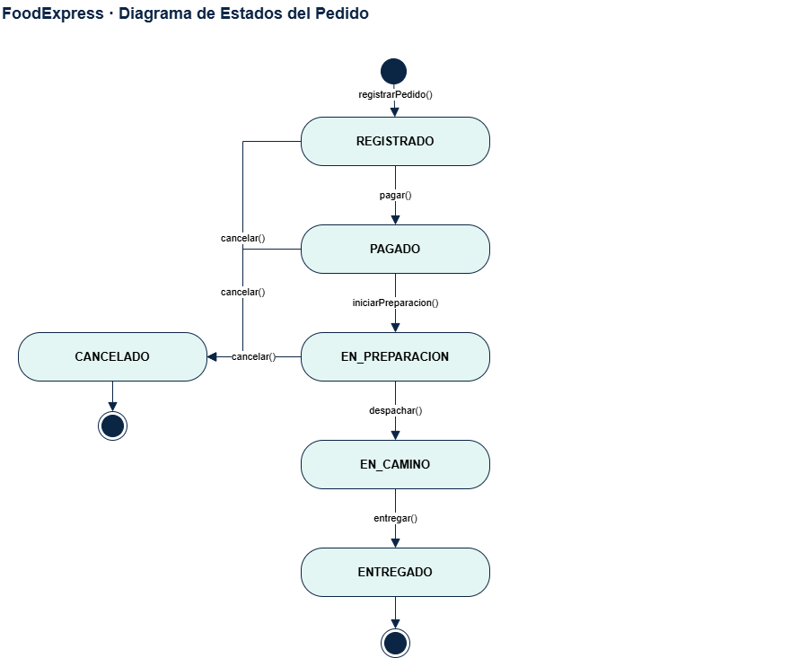

# FoodExpress

Documentación del modelo UML de FoodExpress desarrollado en Draw.io.

> El archivo editable completo está disponible en
> [`FoodExpress_base.drawio`](./FoodExpress_base.drawio).

## Diagramas incluidos

### 1. Casos de uso

Representa las funcionalidades principales del sistema y la interacción con:

- Cliente
- Administrador
- Repartidor
- Pasarela de Pagos

Incluye los casos de uso de los requerimientos RF-01 a RF-09, además de:

- `Registrar pedido` incluye `Calcular total`.
- `Aplicar cupón` extiende opcionalmente `Pagar pedido`.
- La Pasarela de Pagos se relaciona únicamente con `Pagar pedido`.

### 2. Diagrama de clases

Modela las entidades principales del sistema:

- `Usuario`, como clase abstracta.
- `Cliente`, `Repartidor` y `Administrador`.
- `Producto`, `Catalogo`, `Pedido` y `DetallePedido`.
- `EstadoPedido`, como enumeración.
- `MetodoPago`, como interfaz.
- `PagoTarjeta`, `PagoBilletera` y `PagoEfectivo`.
- `ServicioPedido` y `ServicioNotificacion`.

Se incluyen atributos, métodos, relaciones UML y multiplicidades. `Pedido`
compone sus detalles, `Catalogo` agrega productos y las clases de pago
implementan la interfaz `MetodoPago`.

### 3. Diagrama de secuencia

Describe el flujo para registrar y pagar un pedido mediante seis líneas de
vida:

1. Cliente
2. `:ServicioPedido`
3. `:Pedido`
4. `:MetodoPago`
5. Pasarela de Pagos
6. `:ServicioNotificacion`

El flujo incluye el registro del pedido, la incorporación de detalles, el
cálculo del total, la autorización del pago, el cambio de estado y la
notificación al cliente. También se representan los fragmentos `loop` y `alt`,
además de los mensajes de retorno discontinuos.

### 4. Diagrama de estados

Representa el ciclo de vida de un pedido, desde `REGISTRADO` hasta
`ENTREGADO`.

El pedido puede pasar a `CANCELADO` desde los estados permitidos por las
reglas de negocio. `ENTREGADO` y `CANCELADO` son estados finales.

## Archivo principal

El modelo completo se encuentra en
[`FoodExpress_base.drawio`](./FoodExpress_base.drawio).
